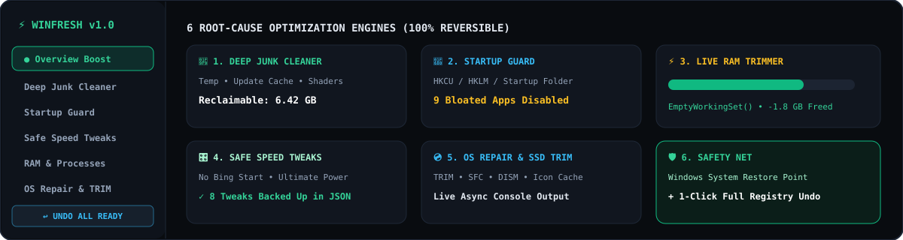
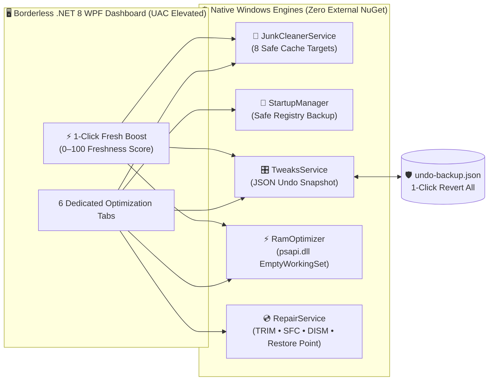

<a id="readme-top"></a>

<!-- CUSTOM 60FPS ANIMATED HERO BANNER -->
<div align="center">
  <a href="https://github.com/a1n2a3s6/winfresh-studio/releases">
    
  </a>

  <br />
  <br />

  <!-- LIVE GITHUB STATS & DOWNLOAD BADGES -->
  <p>
    <a href="https://github.com/a1n2a3s6/winfresh-studio/releases">
      
    </a>
    <a href="https://github.com/a1n2a3s6/winfresh-studio/stargazers">
      
    </a>
    <a href="https://github.com/a1n2a3s6/winfresh-studio/network/members">
      
    </a>
    
    
  </p>

  <!-- QUICK NAVIGATION -->
  <p>
    <a href="#-6-root-cause-engines-preview"><strong>🎬 Dashboard Preview</strong></a> &nbsp;│&nbsp;
    <a href="#-why-windows-slows-down"><strong>🎯 Why It Works</strong></a> &nbsp;│&nbsp;
    <a href="#-bento-feature-suite"><strong>⚡ Features</strong></a> &nbsp;│&nbsp;
    <a href="#-architecture"><strong>🏗️ Architecture</strong></a> &nbsp;│&nbsp;
    <a href="#-download--install"><strong>📦 Download .EXE</strong></a>
  </p>
</div>

---

> [!IMPORTANT]
> **Make Windows feel like Day 1 after a clean install — without formatting your PC and without shady "PC Booster" ads.**
> **WinFresh Studio** is a 100% open-source **C# (.NET 8 WPF)** optimization suite that fixes all **6 real root causes** of Windows slowdown — Startup Bloat, Deep Junk & Update Caches, Telemetry & UI Lag, RAM Pressure, SSD TRIM, and System File Corruption — protected by a **1-Click System Restore Point** and **Full JSON Undo**.

---

## 🎬 6 Root-Cause Engines Preview

<div align="center">
  
</div>

---

## 🎯 Why Windows Slows Down (And How WinFresh Fixes It)

| Root Cause of Windows Lag | ⚡ WinFresh Studio Fix | Reversible? |
| :--- | :--- | :---: |
| **Bloated Startup Programs** | Safe Startup Guard moves disabled items to backup key | ✅ 1-Click Re-enable |
| **Gigabytes of Temp, Update & Shader Junk** | Deep Cleaner wipes 8 safe caches (never touches passwords!) | ✅ Safe Caches Only |
| **Sluggish Start Menu & Telemetry Overhead** | Disables Bing Start Search, DiagTrack & Startup Delay | ✅ JSON Undo Backup |
| **Stale Background RAM Consumption** | Native `EmptyWorkingSet` trimmer + Heavy Process inspector | ✅ Non-Destructive |
| **Degraded SSD Speed & Corrupt OS Files** | Guided **SSD TRIM**, **SFC `/scannow`**, **DISM** & **Icon Cache** | ✅ Native OS Tools |
| **Power Throttling & GameDVR Overhead** | Unlocks **Ultimate Performance** Power Plan & disables GameDVR | ✅ 1-Click Undo All |

---

## ⚡ Bento Feature Suite

<table>
  <tr>
    <td width="33%" valign="top">
      <h3>⚡ 1-Click Fresh Boost</h3>
      <p>Calculates your live <b>Freshness Score (0–100)</b> and lets non-technical users clean junk, trim RAM, flush DNS, and apply safe speed tweaks in one click.</p>
    </td>
    <td width="33%" valign="top">
      <h3>🧹 Safe Deep Junk Cleaner</h3>
      <p>Clears <code>%TEMP%</code>, <code>Windows\Temp</code>, Windows Update cache, browser disk caches (zero cookies/passwords touched), DirectX Shaders, crash dumps &amp; Recycle Bin.</p>
    </td>
    <td width="33%" valign="top">
      <h3>🚀 Reversible Startup Guard</h3>
      <p>Inspects <code>HKCU</code>, <code>HKLM</code>, and Startup Folder entries with boot-impact badges. Disabling backs up the exact value so re-enabling works cleanly.</p>
    </td>
  </tr>
  <tr>
    <td width="33%" valign="top">
      <h3>🎛️ Real Speed Tweaks</h3>
      <p>Disable Bing Start Search, remove Startup App Delay, unlock Ultimate Performance Power Plan, cut sluggish fade animations, and stop background telemetry.</p>
    </td>
    <td width="33%" valign="top">
      <h3>💿 OS Repair &amp; SSD TRIM</h3>
      <p>Run <b>SSD TRIM</b>, <b>SFC</b>, <b>DISM</b>, and <b>Explorer/Icon Cache Rebuild</b> from one clean interface with live streaming console output.</p>
    </td>
    <td width="33%" valign="top">
      <h3>🛡️ Restore Point &amp; Undo All</h3>
      <p>Create a real <b>Windows System Restore Point</b> in 1 click, and revert every Registry/System tweak anytime from <code>undo-backup.json</code>.</p>
    </td>
  </tr>
</table>

---

## 🏗️ Architecture



<details>
<summary><b>📂 Inspect Full C# .NET 8 Repository Structure</b></summary>

```text
winfresh-studio/
├── .github/
│   └── workflows/
│       └── release.yml                # Auto-builds standalone winfresh-windows-x64.exe
├── assets/
│   ├── hero.svg                       # Custom 60fps animated hero banner
│   └── dashboard-demo.svg             # Animated 6-engine dashboard preview
├── src/
│   └── WinFresh/
│       ├── WinFresh.csproj            # net8.0-windows WPF (Zero external NuGet deps)
│       ├── app.manifest               # Clean UAC requireAdministrator manifest
│       ├── App.xaml / App.xaml.cs
│       ├── Models/
│       │   └── OptimizationModels.cs
│       ├── Engine/
│       │   ├── TelemetryService.cs    # Live RAM, Disk, Uptime & Freshness Score
│       │   ├── JunkCleanerService.cs  # Safe 8-category junk scanner & cleaner
│       │   ├── StartupManager.cs      # Reversible Startup item guard
│       │   ├── TweaksService.cs       # Reversible speed tweaks + JSON Undo
│       │   ├── RamOptimizer.cs        # EmptyWorkingSet RAM trimmer & process viewer
│       │   └── RepairService.cs       # Restore Point, SSD TRIM, SFC, DISM & Icon Cache
│       └── Views/
│           └── MainWindow.xaml(.cs)   # Dark matte 6-tab Fluent dashboard
└── README.md
```

</details>

---

## 📦 Download & Install

### Option 1: Standalone Windows `.EXE` (Zero Install)
Download **`winfresh-windows-x64.exe`** directly from **[GitHub Releases](https://github.com/a1n2a3s6/winfresh-studio/releases)** and run (UAC Administrator prompt will appear so OS repairs & caches work cleanly).

### Option 2: Build From Source (.NET 8 SDK)
```powershell
git clone [https://github.com/a1n2a3s6/winfresh-studio.git](https://github.com/a1n2a3s6/winfresh-studio.git)
cd winfresh-studio
dotnet run --project src/WinFresh/WinFresh.csproj
```

---

## 📄 License

Distributed under the **MIT License**. 100% open source, zero ads, zero telemetry.

---

<div align="center">

<h3>👨‍💻 Engineered by Anas Alhelaly</h3>
<p><em>Day 16 of my <strong>365 Projects in 365 Days</strong> GitHub Challenge</em></p>

<p>
  <a href="https://anas-alhelaly.vercel.app/">
    
  </a>
  <a href="https://github.com/a1n2a3s6">
    
  </a>
  <a href="https://www.instagram.com/anas.alhelaly/">
    
  </a>
</p>

<p>⭐ <strong>If WinFresh Studio brought your Windows PC back to life, drop a Star on the repo!</strong> ⭐</p>

<p><a href="#readme-top"><strong>⬆️ Back to Top</strong></a></p>

</div>
